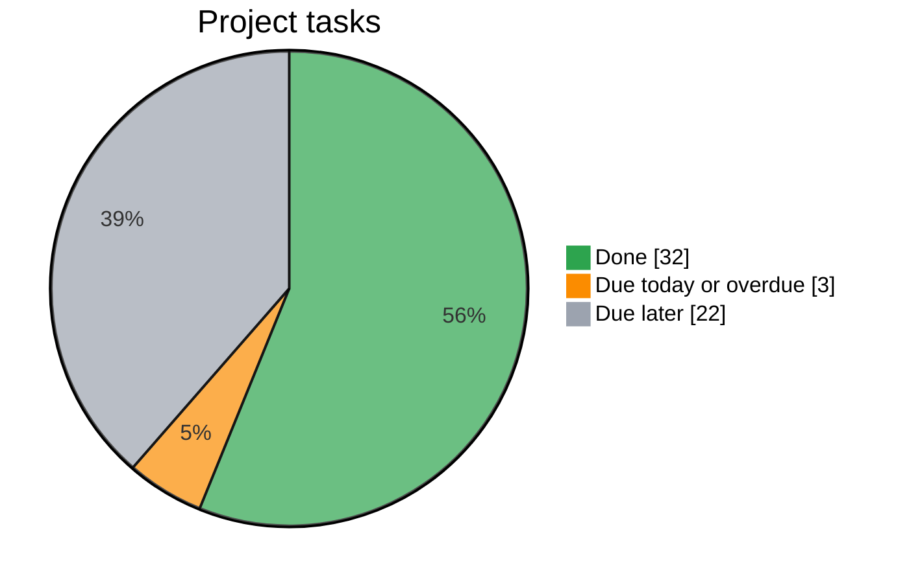

# IKT466 – Corporate Bankruptcy Predictor

<!-- task-dashboard:start -->
## Project progress

**Finish by 22 November 2026 · 32/57 tasks complete (56%)**



Counts exclude pull requests and parent issues to avoid counting work twice.
Open tasks with a due date on or before today appear in **Due today or overdue**.
Tasks without a deadline are also included there (0 currently).
Deadlines use exact date labels such as `due:2026-11-09`.

Updated 2026-11-11 (Europe/Oslo). Refreshes when issues change and daily.
Plan: data preparation by **15 Nov**, model training by **16 Nov**, experiments by
**20 Nov**, discussion and conclusions by **21 Nov**, final review by **22 Nov**.
<!-- task-dashboard:end -->

Project for the Introduction to Machine Learning course (IKT466) at UiA.

We compare logistic regression, XGBoost, MLP and GRU using either the **latest
recorded year** or the **five most recent recorded years** for each company. All eight
model/input combinations use the same company split and separate Optuna studies.

The agreed protocol is in [docs/study-design.md](docs/study-design.md). A revised,
drop-in report introduction is in [report/introduction.tex](report/introduction.tex).

## 1. Task, data and research question

**Task:** binary classification. Given a company's accounting data up to its last recorded year *t*, does it file for bankruptcy (Chapter 7/11) in year *t*+1 (`failed`) or not (`alive`)? See section 11 for the exact target and its limitations.

**Dataset:** US public companies bankruptcy dataset (Lombardo et al., *Future Internet* 14(8):244, 2022).
- 8,971 companies listed on NYSE/NASDAQ, 1999–2018
- 78,682 firm-year rows with 18 accounting variables each
- Label: `status_label` (`alive` / `failed`), a company-level status used only at each company's last recorded year
- 609 failed companies (≈ 6.8%)

**Research question:**

> Does using five years of financial observations improve corporate bankruptcy prediction compared with using only the latest year, and how does this effect differ across model families?

## 2. Models and input conditions

| Model | Latest-year condition | Five-year condition |
|---|---|---|
| Logistic regression | Latest annual features | Flattened five-year history |
| XGBoost | Latest annual features | Flattened five-year history |
| MLP | Latest annual features | Flattened five-year history |
| GRU | One annual observation | Up to five recorded observations as a sequence |

Each cell is trained and tuned separately: **eight configurations**. The
five-year condition uses the five most recent recorded years up to *t* (all of
them when a company has fewer) and excludes older records. Short histories are
kept. SVM is outside the agreed scope (five-year decision: #16, 10 Nov 2026).

## 3. History representation

All inputs end at the same company-specific final recorded year *t*. The GRU
reads real observations oldest to newest and ignores padding using real lengths.
The other models receive the same financial history flattened into fixed-width,
recency-aligned slots, with presence indicators and relative time offsets. Missing
calendar years must remain distinguishable from consecutive observations.

The five-year window holds at most five records; with gaps they can span more
than five calendar years. Fit preprocessing only on valid training records. Implemented in `src/sequences.py` (section 12).

## 4. Investigations

1. **Model comparison:** compare all four families within each input condition.
2. **Value of history:** compare latest-year versus five-year performance
   within each family, including results grouped by available history.

This replaces the GRU-only 1–5-year sweep. It tests the value of up to five
years of history, not the optimal number of years. Five-year gains may also
reflect history length/missingness signals and separately selected model capacity.

### Optuna tuning

Use one independent Optuna study per model/input combination, maximising
validation **Average Precision (AP)** with seeded `TPESampler`. Use the same
search method and predeclared trial budget for all eight studies; the initial
planning budget is 20 attempted trials per study. Model-specific search spaces
stay consistent between paired input conditions where applicable. Best settings
are allowed to differ. Record actual computing cost as well as trial counts.

Optuna selects hyperparameters and **class/loss weights**. Model coefficients,
tree parameters and neural network weights are learned during training inside
each trial. Training-label statistics determine any class-weight ranges; neither
validation nor test data is resampled or reweighted. See the protocol for seeds,
stopping rules, failed trials, search records and remaining implementation work.

## 5. Evaluation

- Reuse one persisted 70/15/15 company split for every model and input condition
- Stratify jointly by outcome and recorded-history group (1, 2, 3, 4, 5+),
  preserving approximately similar proportions rather than balancing the classes
- **Main metric: Average Precision (AP)**, not trapezoidal PR area
- Report precision, recall and F1 with validation-selected thresholds
- Keep test IDs, anchors and outcomes identical; freeze settings before testing
- Report history-group sample sizes, prevalence, AP changes and computing cost
- Error analysis of missed bankruptcies and false alarms

## 6. Reproducibility

The repository will contain the code, configurations, split definitions and saved results needed to reproduce the main comparisons.
Include Optuna study/trial records, search spaces, sampler/training seeds, selected
class weights, preprocessing schemas and the checkpoint for each neural evaluation.

## 7. Repository structure

The project uses a simple `src/` layout without an additional project-package folder.

```text
.
├── README.md
├── requirements.txt
├── pyproject.toml
├── .gitignore
├── main.py                       # Shortcut for dataset inspection
├── configs/config.yaml
├── data/
│   ├── raw/
│   ├── processed/
│   └── splits/
├── src/
│   ├── data_loader.py            # Existing Kaggle download and CSV loading
│   ├── validation.py             # Dataset validators and real-data audit
│   ├── preprocessing.py          # Company splits, imputation/scaling
│   ├── sequences.py              # Latest-year/five-year GRU and tabular inputs
│   ├── metrics.py
│   ├── evaluation.py
│   ├── visualization.py
│   └── models/
│       ├── __init__.py
│       ├── logistic_regression.py
│       ├── xgboost_model.py
│       ├── mlp_model.py
│       └── gru_model.py
├── scripts/
│   ├── inspect_data.py           # Runs the audit, saves results/metrics/data_audit.json
│   ├── prepare_data.py
│   ├── train_logistic.py
│   ├── train_xgboost.py
│   ├── train_mlp.py
│   ├── train_gru.py
│   ├── compare_models.py
│   └── compare_lookback.py         # Legacy stub; to become paired input-condition comparison
├── tests/
│   ├── test_validation.py
│   ├── test_preprocessing.py
│   ├── test_sequences.py
│   └── test_splits.py
└── results/
    ├── figures/
    ├── metrics/
    └── models/
```

Data and results directories contain tracked `.gitkeep` markers. Generated data,
models, and results are ignored by Git.

## 8. Setup and implementation status

Use Python 3.10+ (3.12 recommended). From the repository root:

```bash
python3.12 -m venv .venv
source .venv/bin/activate
python -m pip install -e .
python scripts/inspect_data.py
python scripts/prepare_data.py   # creates data/splits/ (see section 12)
python -m pytest
```

Editable installation makes the modules importable without the former
`bankruptcy_ml` prefix:

```python
from data_loader import load_data
from models.logistic_regression import build_model
```

`main.py` delegates to the dataset audit script. It downloads into KaggleHub's
cache, runs every validator in `src/validation.py`, prints a summary and saves the
full report to `results/metrics/data_audit.json` (see section 10).
The local CSV path in the config is separate from that cache. Run scripts from
the repository root; future config loading should resolve paths with `pathlib`.

Downloading/loading, dataset validation, jointly stratified company splits,
latest-year and five-year inputs (GRU sequences and flattened tables), shared
metrics/reproducibility helpers and aligned saved-prediction comparison are
implemented, as are the fixed per-condition scaling (`docs/preprocessing.md`)
and the leakage audit (`scripts/audit_leakage.py`, `docs/leakage-audit.md`).
The [Logistic Regression](docs/logistic-experiments.md) and
[XGBoost](docs/xgboost-experiments.md) runners implement separate latest-year
and five-year validation-only Optuna studies using the shared prepared artifact.
MLP/GRU runners and plotting remain incomplete; the complete eight-study
workflow and cross-model reporting are still pending.
No trained models or experimental results are included. Settings marked `null`
are unresolved choices, not runnable defaults.

## 9. Planned implementation order

1. Audit company IDs, years, and provided labels in `data_loader.py`,
   `preprocessing.py`, and `inspect_data.py`.
2. Implement reproducible company-disjoint splits and training-only preprocessing.
3. Select the latest five recorded years and implement matched flattened and
   sequential inputs, padding indicators, time offsets and tests.
4. Integrate every model with the common Optuna protocol, train-only preparation
   and model/condition-specific saved artifacts.
5. Run the eight configurations, compare models and paired history conditions,
   inspect errors and document measured results.

Every model receives both input conditions. Between-family comparisons hold the
available information fixed; within-family comparisons change input condition
and allow validation-selected hyperparameters to change. Interpret these as
comparisons after comparable tuning, not isolated causal effects of adding years.
Use feature branches and teammate-reviewed pull requests; record split decisions,
experiment settings, dataset version, and contributions in tracked documentation.

## 10. Data audit (issue #44)

Run `python scripts/inspect_data.py` to reproduce. The script exits with an error
on ambiguous records (duplicate company/years, labels that change within a
company, infinite values, schema mismatches) or if the file checksum differs from
`configs/config.yaml`. Optionally add `--publisher-csv <path>` with the
publisher's CSV ([sowide/bankruptcy_dataset](https://github.com/sowide/bankruptcy_dataset),
commit `8bcd8db`) to compare the two files.

**Audited file:** Kaggle `utkarshx27/american-companies-bankruptcy-prediction-dataset`,
version 3, `american_bankruptcy.csv`, SHA-256 `cff2c899…419b5e` (audited 2026-11-03).

| Check | Result |
|---|---|
| Rows / companies / years | 78,682 / 8,971 / 1999–2018 (matches section 1) |
| Failed companies | 609 (6.79% of companies); 5,220 failed rows (6.63% of rows) |
| Missing, infinite, duplicate company/year | none |
| Years per company | 1–20, median 7; 710 companies have gaps (1,851 missing years) |
| Companies with *k* consecutive years ending at *t* | k=1: 8,971 (609 failed) · 2: 8,078 (594) · 3: 7,101 (564) · 4: 6,298 (514) · 5: 5,600 (476) |
| Identical columns | `X9` and `X16` are identical in every row |

**Findings that matter for the target (#45):**

- `status_label` is a **company-level** label: it is the same in every year of a
  company. 4,611 of the 5,220 failed rows are *not* the company's last year, so
  earlier failed rows must not be used as t+1 positives. The CSV does not follow
  the publisher's documented year-level convention ("fiscal year before the
  filing is labelled bankrupt").
- That the last year of a failed company is the year before its filing comes from
  the publisher's documentation; the CSV cannot prove it. 36 failed companies end
  in 2018, so their filing would fall outside the data.
- 5,675 alive companies leave the panel before 2018 and 2,687 end in 2018; their
  t+1 outcome is not observable in the CSV.

**Kaggle file vs publisher:**

- The publisher's README says 8,262 companies; both CSVs actually contain 8,971.
- Same rows and identical labels, but the **X1–X18 names are reordered** between
  the files. Kaggle → publisher: X1→X1, X2→X3, X3→X5, X4→X7, X5→X9, X6→X11,
  X7→X13, X8→X15, X9→X14/X17, X10→X2, X11→X4, X12→X6, X13→X8, X14→X10,
  X15→X12, X16→X14/X17, X17→X16, X18→X18 (the duplicated pair is X9/X16 in
  Kaggle and X14/X17 in the publisher file). The feature meanings in section 11
  apply to the Kaggle file and are confirmed against its values.
- In the publisher's CSV, 64.5% of values are exactly 1000× the Kaggle value (a
  lost decimal point). About 23.8% of the publisher's year-over-year changes are
  ~1000× jumps, against 0.06% in the Kaggle file, so we use the Kaggle file.
- "No missing values" is confirmed in the CSV. "No synthetic or imputed values"
  can only be taken from the publisher; the CSV shows no copied feature rows
  within a company, which is consistent with it but not proof.


## 11. Data dictionary and target (issue #45)

The checks below run as part of `python scripts/inspect_data.py`; the contract is
implemented in `src/validation.py`.

### Columns

| Column | Role |
|---|---|
| `company_name` | Anonymised company ID (`C_<number>`). Never a model input. |
| `year` | Fiscal year (integer, 1999–2018). Never a model input. |
| `status_label` | `alive` / `failed`, the same in every year of a company. Never a model input; used only to build the target. |
| `X1`–`X18` | The only predictors (`validate_predictor_columns` rejects anything else). |

### Features

Names come from the Kaggle dataset description (version 3). The publisher's
GitHub README gives no definitions, and its CSV uses a different column order, so
these names apply to the Kaggle file only. Neither source states units; the
magnitudes (median total assets 213.2, three decimals) are consistent with
millions of USD, but this is an inference.

| Column | Meaning | Kind |
|---|---|---|
| X1 | Current assets | year-end balance |
| X2 | Cost of goods sold | fiscal-year flow |
| X3 | Depreciation and amortization | fiscal-year flow |
| X4 | EBITDA | fiscal-year flow |
| X5 | Inventory | year-end balance |
| X6 | Net income | fiscal-year flow |
| X7 | Total receivables | year-end balance |
| X8 | Market value (market capitalization) | market |
| X9 | Net sales | fiscal-year flow |
| X10 | Total assets | year-end balance |
| X11 | Total long-term debt | year-end balance |
| X12 | EBIT | fiscal-year flow |
| X13 | Gross profit | fiscal-year flow |
| X14 | Total current liabilities | year-end balance |
| X15 | Retained earnings | year-end balance |
| X16 | Total revenue | fiscal-year flow |
| X17 | Total liabilities | year-end balance |
| X18 | Total operating expenses | fiscal-year flow |

**Verified against the data.** If the names are right, the values must satisfy
accounting relations. Each holds in at least 99.99% of the 78,682 rows (1–7 rows
off per relation), and the audit fails if any relation drops below 99%:

- gross profit = net sales − COGS (X13 = X9 − X2)
- EBIT = EBITDA − D&A (X12 = X4 − X3)
- EBITDA = total revenue − operating expenses (X4 = X16 − X18)
- current assets ≤ total assets; inventory, receivables ≤ current assets;
  current and long-term liabilities ≤ total liabilities; COGS ≤ operating expenses

X9 (net sales) and X16 (total revenue) are identical in every row. Whether to
drop one is a preprocessing decision (#46/#48).

### Company IDs and year order

All 8,971 IDs match `C_<number>`; there are no duplicate company/years; each
company's rows are contiguous and in increasing year order in the file. Code must
not rely on file order: use `sort_panel` (numeric company ID, then oldest year
first). IDs are anonymised, so the CSV cannot show that an ID is the same legal
entity in every year; this is taken from the publisher.

### Target

`anchor_targets` defines the target once for all models:

- One observation per company, anchored at its **last recorded year *t***.
- `target = 1` if the company's `status_label` is `failed`, otherwise `0`
  (609 positives of 8,971 companies, 6.79%).
- Intended meaning, from the publisher and Kaggle documentation: the fiscal year
  before a Chapter 7/11 filing is labelled bankrupt "for the next year", so
  `target = 1` means a filing in *t*+1.
- Earlier rows of a failed company carry the same company label (4,611 rows)
  and are **never** used as positives.

**Why `target_verified` stays `false`.** The label consistency shows only that the
label is company-level; it does not prove the timing:

| Group | Companies | What the CSV cannot show |
|---|---|---|
| Failed, last year before 2018 | 573 | That the filing happened in *t*+1 (filing dates are not in the CSV) |
| Failed, last year 2018 | 36 | The filing year falls outside the data |
| Alive, last year 2018 | 2,687 | Their 2019 outcome; relies on the publisher's follow-up |
| Alive, leave before 2018 | 5,675 | Why they left (merger, delisting, going private, …); their 0 relies on the publisher's labelling |

So the target is "bankruptcy in *t*+1 according to the publisher", not an
independently verified event. Results and the report should use that wording.

## 12. Split and model inputs (issues #47, #48–#51)

### Company split

`python scripts/prepare_data.py` assigns every company, with all its years, to one
partition and writes `data/splits/{train,validation,test}.csv` (gitignored). Each
file stores the company's anchor year, target and number of recorded years.

- **70 / 15 / 15**, seed 42, stratified by **outcome × recorded years** (1, 2, 3,
  4, 5+), so partitions have approximately the same failure rate and mix of short
  and long histories.
- The SHA-256 of each file is in `configs/config.yaml`. The script fails if a
  regenerated split differs, and runners load the split with
  `preprocessing.load_splits`, which never regenerates it.
- The smallest group is failed companies with one recorded year (10 companies),
  so validation and test hold only 1–2 of them each.

| Partition | Companies | Failed | 1 / 2 / 3 / 4 / 5+ years |
|---|---|---|---|
| Train | 6,279 | 426 (6.78%) | 8.4 / 10.1 / 8.4 / 7.6 / 65.5% |
| Validation | 1,346 | 91 (6.76%) | 8.4 / 10.1 / 8.5 / 7.6 / 65.5% |
| Test | 1,346 | 92 (6.84%) | 8.5 / 10.1 / 8.4 / 7.6 / 65.5% |

Full counts per partition are in `results/metrics/split_summary.json`.

### Model inputs

`src/sequences.py` builds both input conditions from the same records, for the
same companies, anchors and targets.

| | GRU (`create_histories`) | LR / XGBoost / MLP (`tabular_inputs`) |
|---|---|---|
| `latest_year` | 1 step: X1–X18 at *t* | 18 columns: X1–X18 at *t* |
| `five_year` | Up to 5 steps: X1–X18 + `years_before_anchor`, oldest to newest, zero padding after the real steps | 5 slots × (X1–X18, `years_before_anchor`, `present`) = 100 columns, aligned so the record at *t* is always slot `r0` |

- **The latest five records up to *t*.** Companies with fewer keep all of
  them; older records are dropped. On the real data 36,924 of the 78,682 rows
  are used; 5,257 companies lose older records and 5,873 fill all five slots.
- **Missing calendar years are skipped, not filled.** Every record carries
  `years_before_anchor` = *t* − year, so gaps stay visible: 2005, 2006, 2008
  with *t* = 2008 gives offsets 3, 2, 0. 395 companies have a gap inside the
  window, so their five records span more than five calendar years.
- **GRU padding:** `lengths` stores the real length and `pack_histories` wraps
  PyTorch's `pack_padded_sequence`, so the GRU never reads padding and its final
  hidden state is the state at *t*.
- **Tabular padding:** empty slots are 0 with `present` = 0 and sit at the old
  end. The same table is used for LR, XGBoost and MLP. A quick validation check
  of XGBoost with NaN instead of 0 + flag gave the same AP within seed noise, so
  identical inputs across model families were kept.
- **Same information in both layouts:** a test checks that every flattened slot
  equals the corresponding GRU step.
- **Latest year adds nothing else:** no history length or temporal fields. A
  one-record company has the same financial values in both conditions.
- **Padding never enters fitted preprocessing:** scaling (#46) uses signed
  log1p followed by one StandardScaler per condition, fitted on the real
  training records of that condition only; padded slots are set back to 0
  afterwards. XGBoost is not scaled. Details: [docs/preprocessing.md](docs/preprocessing.md).
- **Schema checks:** raw ID/label/year are never predictors, and the derived
  columns are validated against their exact expected order
  (`validate_tabular_columns`).
- Every company is used in both conditions; history length and gaps can
  themselves carry signal (see docs/study-design.md).

| Partition | Companies | Records | Records per company (median / max) | Companies with gaps |
|---|---|---|---|---|
| Train | 6,279 | 55,302 | 7 / 20 | 483 |
| Validation | 1,346 | 11,594 | 7 / 20 | 122 |
| Test | 1,346 | 11,786 | 7 / 20 | 105 |

The previous k = 1–5 lookback API was replaced by these two conditions.
