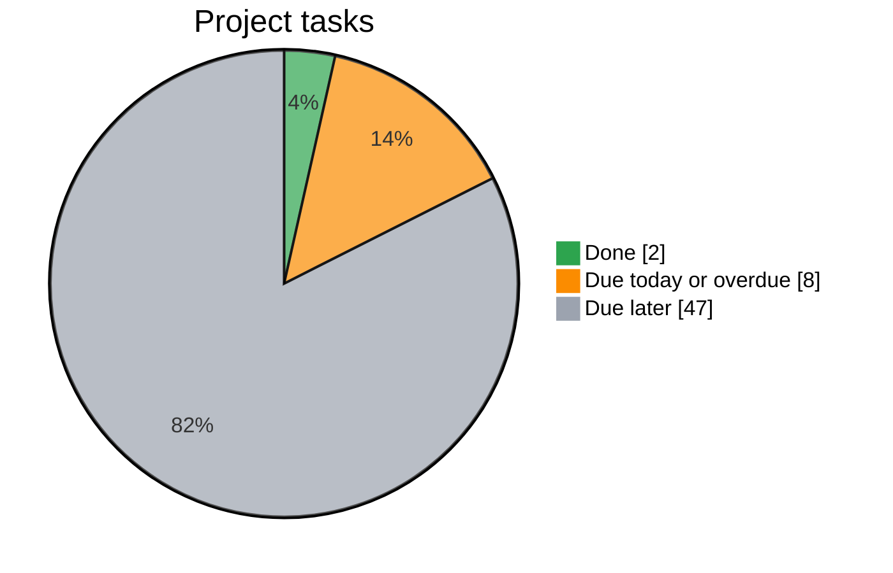

# IKT466 – Corporate Bankruptcy Predictor

<!-- task-dashboard:start -->
## Project progress

**Finish by 22 November 2026 · 2/57 tasks complete (4%)**



Counts exclude pull requests and parent issues to avoid counting work twice.
Open tasks with a due date on or before today appear in **Due today or overdue**.
Tasks without a deadline are also included there (0 currently).
Deadlines use exact date labels such as `due:2026-11-09`.

Updated 2026-11-09 (Europe/Oslo). Refreshes when issues change and daily.
Plan: data preparation by **15 Nov**, model training by **16 Nov**, experiments by
**20 Nov**, discussion and conclusions by **21 Nov**, final review by **22 Nov**.
<!-- task-dashboard:end -->

Project for the Introduction to Machine Learning course (IKT466) at UiA.

We predict whether a US public company goes bankrupt from its yearly accounting data, and test whether a **GRU over multi-year financial history** beats models that only see the **latest year**.

## 1. Task, data and research question

**Task:** binary classification. Given a company's accounting data, did it go bankrupt (`failed`) or not (`alive`)?

**Dataset:** US public companies bankruptcy dataset (Lombardo et al., *Future Internet* 14(8):244, 2022).
- 8,971 companies listed on NYSE/NASDAQ, 1999–2018
- 78,682 firm-year rows with 18 accounting variables each
- Label: `status_label` (`alive` / `failed`), used as provided
- 609 failed companies (≈ 6.8%)

**Research question:**

> Does modelling a company's multi-year financial history with a GRU predict bankruptcy better than using only its latest year? How many years of history actually help?

## 2. Baselines

- Logistic regression
- XGBoost
- MLP

All baselines use only the company's latest year, so comparing them with the GRU shows the value of history.

## 3. Neural model

A GRU that reads a company's last *k* years of accounting data, starting from the latest year and adding years backwards in time.

## 4. Investigations

1. **Baseline comparison:** logistic regression vs XGBoost vs MLP vs GRU.
2. **History length:** the GRU with *k* = 1, 2, 3, 4 and 5 years.

## 5. Evaluation

- Separate training, validation and test sets, split by company
- **Main metric: PR-AUC**, because bankruptcies are rare and accuracy would be misleading
- Precision and recall reported together
- Error analysis of missed bankruptcies and false alarms

## 6. Reproducibility

The repository will contain the code, configurations, split definitions and saved results needed to reproduce the main comparisons.

## 7. Repository structure

The project uses a simple `src/` layout without an additional project-package folder.

```text
.
├── README.md
├── requirements.txt
├── pyproject.toml
├── .gitignore
├── main.py                       # Shortcut for dataset inspection
├── configs/config.yaml
├── data/
│   ├── raw/
│   ├── processed/
│   └── splits/
├── src/
│   ├── data_loader.py            # Existing Kaggle download and CSV loading
│   ├── validation.py             # Dataset validators and real-data audit
│   ├── preprocessing.py          # Company splits, imputation/scaling
│   ├── sequences.py              # Latest-year selection and GRU histories
│   ├── metrics.py
│   ├── evaluation.py
│   ├── visualization.py
│   └── models/
│       ├── __init__.py
│       ├── logistic_regression.py
│       ├── xgboost_model.py
│       ├── mlp_model.py
│       └── gru_model.py
├── scripts/
│   ├── inspect_data.py           # Runs the audit, saves results/metrics/data_audit.json
│   ├── prepare_data.py
│   ├── train_logistic.py
│   ├── train_xgboost.py
│   ├── train_mlp.py
│   ├── train_gru.py
│   ├── compare_models.py
│   └── compare_lookback.py         # GRU only, k = 1–5
├── tests/
│   ├── test_validation.py
│   ├── test_preprocessing.py
│   ├── test_sequences.py
│   └── test_splits.py
└── results/
    ├── figures/
    ├── metrics/
    └── models/
```

Data and results directories contain tracked `.gitkeep` markers. Generated data,
models, and results are ignored by Git.

## 8. Setup and implementation status

Use Python 3.10+ (3.12 recommended). From the repository root:

```bash
python3.12 -m venv .venv
source .venv/bin/activate
python -m pip install -e .
python scripts/inspect_data.py
python -m pytest
```

Editable installation makes the modules importable without the former
`bankruptcy_ml` prefix:

```python
from data_loader import load_data
from models.logistic_regression import build_model
```

`main.py` delegates to the dataset audit script. It downloads into KaggleHub's
cache, runs every validator in `src/validation.py`, prints a summary and saves the
full report to `results/metrics/data_audit.json` (see section 10).
The local CSV path in the config is separate from that cache. Run scripts from
the repository root; future config loading should resolve paths with `pathlib`.

Downloading/loading and dataset validation are implemented. Model, preprocessing,
evaluation, and plotting interfaces raise `NotImplementedError`; their tests are
explicitly skipped.
No trained models or experimental results are included. Settings marked `null`
are unresolved choices, not runnable defaults.

## 9. Planned implementation order

1. Audit company IDs, years, and provided labels in `data_loader.py`,
   `preprocessing.py`, and `inspect_data.py`.
2. Implement reproducible company-disjoint splits and training-only preprocessing.
3. Implement latest-year baseline inputs and aligned GRU histories; agree short
   history and missing-year policies and add meaningful tests.
4. Implement shared metrics/evaluation, then each model and its training entry
   point step by step.
5. Run the two planned experiments, inspect errors, and document measured results.

All baselines receive only latest-year features. The GRU history experiment holds
model family fixed; the baseline-versus-GRU comparison changes both architecture
and history, which should be discussed when interpreting improvements.
Use feature branches and teammate-reviewed pull requests; record split decisions,
experiment settings, dataset version, and contributions in tracked documentation.

## 10. Data audit (issue #44)

Run `python scripts/inspect_data.py` to reproduce. The script exits with an error
on ambiguous records (duplicate company/years, labels that change within a
company, infinite values, schema mismatches) or if the file checksum differs from
`configs/config.yaml`. Optionally add `--publisher-csv <path>` with the
publisher's CSV ([sowide/bankruptcy_dataset](https://github.com/sowide/bankruptcy_dataset),
commit `8bcd8db`) to compare the two files.

**Audited file:** Kaggle `utkarshx27/american-companies-bankruptcy-prediction-dataset`,
version 3, `american_bankruptcy.csv`, SHA-256 `cff2c899…419b5e` (audited 2026-11-03).

| Check | Result |
|---|---|
| Rows / companies / years | 78,682 / 8,971 / 1999–2018 (matches section 1) |
| Failed companies | 609 (6.79% of companies); 5,220 failed rows (6.63% of rows) |
| Missing, infinite, duplicate company/year | none |
| Years per company | 1–20, median 7; 710 companies have gaps (1,851 missing years) |
| Companies with *k* consecutive years ending at *t* | k=1: 8,971 (609 failed) · 2: 8,078 (594) · 3: 7,101 (564) · 4: 6,298 (514) · 5: 5,600 (476) |
| Identical columns | `X9` and `X16` are identical in every row |

**Findings that matter for the target (#45):**

- `status_label` is a **company-level** label: it is the same in every year of a
  company. 4,611 of the 5,220 failed rows are *not* the company's last year, so
  earlier failed rows must not be used as t+1 positives. The CSV does not follow
  the publisher's documented year-level convention ("fiscal year before the
  filing is labelled bankrupt").
- That the last year of a failed company is the year before its filing comes from
  the publisher's documentation; the CSV cannot prove it. 36 failed companies end
  in 2018, so their filing would fall outside the data.
- 5,675 alive companies leave the panel before 2018 and 2,687 end in 2018; their
  t+1 outcome is not observable in the CSV.

**Kaggle file vs publisher:**

- The publisher's README says 8,262 companies; both CSVs actually contain 8,971.
- Same rows and identical labels, but the **X1–X18 names are reordered** between
  the files. Kaggle → publisher: X1→X1, X2→X3, X3→X5, X4→X7, X5→X9, X6→X11,
  X7→X13, X8→X15, X9→X14/X17, X10→X2, X11→X4, X12→X6, X13→X8, X14→X10,
  X15→X12, X16→X14/X17, X17→X16, X18→X18 (the duplicated pair is X9/X16 in
  Kaggle and X14/X17 in the publisher file). Feature meanings must therefore be
  checked against the right file (#45).
- In the publisher's CSV, 64.5% of values are exactly 1000× the Kaggle value (a
  lost decimal point). About 23.8% of the publisher's year-over-year changes are
  ~1000× jumps, against 0.06% in the Kaggle file, so we use the Kaggle file.
- "No missing values" is confirmed in the CSV. "No synthetic or imputed values"
  can only be taken from the publisher; the CSV shows no copied feature rows
  within a company, which is consistent with it but not proof.

